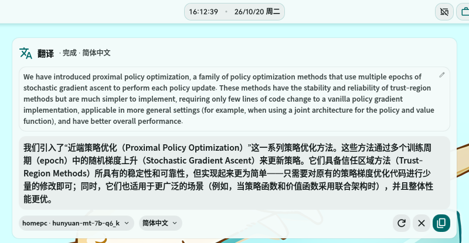
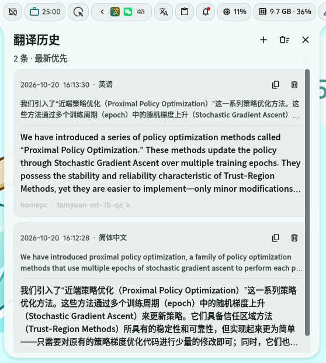

# Dank Translate AI Enhanced

[English](README.md) | [简体中文](README.zh-CN.md)

面向 DankMaterialShell 1.6+ 的翻译插件，基于 [Dank Translate AI](https://github.com/SakuraToErii/dank-translate-ai) 增强。划词或复制文本后按一次快捷键，译文流式输出到屏幕顶部的紧凑卡片；DankBar 里保存最新优先的翻译历史。





## 这个 fork 增加了什么

上游是「一个本地模型 + 一个远程 API」的固定结构，卡片只能看和复制。这个 fork 换成了提供商列表，并补齐了卡片操作与提示词配置：

**提供商与路由**

- 用 `providers` 数组替代本地/远程两个槽位。每项包含名称、Base URL、模型、模型列表、超时和排序。
- 排序即回退顺序：某个提供商超时或报错时，自动尝试下一个。
- 每个提供商一个独立 API Key，存放在 `providerKey_<名称>`。
- 全局默认模型（`提供商 · 模型`）优先于各提供商自己的模型，同时其余提供商仍保留在回退链里。
- 对所有 OpenAI 兼容后端关闭思考（`chat_template_kwargs` + `reasoning_effort`），服务端不认这两个字段时自动剥离重试。

**提示词模板**

- 变量：`${target_lang}`、`${secondary_lang}`、`${text}`。
- 支持 `system:` / `user:` 两段式；没有这两个前缀时整段按 system 处理。
- 可选的 `${secondary_lang}` 变量。默认提示词不引用它——需要副语言时自己写进提示词。

**结果卡片**

- 重试、复制、关闭，流式输出时可中止。
- 原文与译文同框对照；原文可点击编辑，底部变成 ✓ / ✗，`Ctrl+Enter` 直接重译。
- 没有原文时显示手动输入框：默认一行，随内容撑高到 160px 后内部滚动。可以从历史弹窗的 `+`、空触发的快捷键、或卡片本身进入。
- 模型与目标语言下拉框为自实现，固定显示 5 行、垂直滚动——DMS 自带的 `DankDropdown` 在 layer-shell 表面里弹不出来。
- 长译文在卡片内滚动，每次新翻译时滚动位置归零。

**设置页**

- 提供商编辑器：名称、Base URL、掩码显示的 API Key、模型（带「同步」按钮，把 `/v1/models` 拉进下拉框，另有「自定义」项）、超时、排序。
- 排序冲突时，冲突项及之后的提供商整体后移一位。
- 已配置的提供商显示在表单上方：第一行名称，第二行 `Base URL · 模型`，右侧「修改」「删除」。
- 默认模型下拉框的选项由所有 `提供商 · 模型` 组合生成。

**历史弹窗**

- `+` 打开新建翻译，「清空」在其右侧。
- 空状态显示「手动输入翻译」按钮，不再只是提示文案。
- 目标语言经语言表转换显示，跟随 DMS 界面语言。

## 安装

DankMaterialShell 扫描 `~/.config/DankMaterialShell/plugins/<id>/`，插件 `id` 必须保持 `dankTranslateAI`。用软链指向 git 检出目录，方便后续 `git pull` / `git merge`：

```bash
git clone https://github.com/LilFishyChan/dank-translate-ai-enhanced.git ~/code/dank-translate-ai
ln -s ~/code/dank-translate-ai ~/.config/DankMaterialShell/plugins/dankTranslateAI
```

也可以直接复制：

```bash
cp -a dank-translate-ai ~/.config/DankMaterialShell/plugins/dankTranslateAI
```

然后：

1. 在 DMS 设置 → 插件里扫描并启用 **Dank Translate AI Enhanced**。
2. 打开插件设置，至少添加一个提供商（名称、Base URL、模型），或点「同步」从 `/v1/models` 拉取模型列表。
3. 选择默认模型、目标语言，按需设置副语言。
4. 把插件添加到 DankBar 分区。
5. 点「快捷键」下的键盘图标录制组合键，`Esc` 取消录制。

依赖：DankMaterialShell 1.6+、`uv`、`wl-clipboard` 提供的 `wl-paste`。

## 提示词模板

默认提示词刻意不带条件分支：

```text
system: Translate the text provided by the user into ${target_lang}. Preserve the original meaning, tone, paragraph structure, Markdown formatting, code, names, and numbers. Output only the translation.
user: ${text}
```

- `${target_lang}` — 设置里选的目标语言。
- `${secondary_lang}` — 设置里的副语言，默认提示词不引用它。
- `${text}` — 原文。

条件规则交给用户自己写。部分本地模型会忽略这类条件、照旧译成目标语言，所以默认提示词只保留一个目标语言，跨模型更稳。需要副语言时自己加进提示词，例如：

```text
- If the text's dominant language is ${target_lang}, translate it into ${secondary_lang} instead.
```

适配器不做本地语言检测，提示词怎么写，模型就怎么收到。

## 提供商

请求发往任意 OpenAI 兼容的 `/chat/completions` 端点。

```text
名称:     示例提供商1
Base URL: http://127.0.0.1:8080/v1
模型:     示例模型1
超时:     60
排序:     1
```

模型字段可以选同步到的条目，也可以手填模型 ID。同步会把服务端返回的全部模型填进下拉框；自定义留空时保存整个同步列表，并以第一项作为该提供商的默认模型。

密钥保存在 `~/.config/DankMaterialShell/plugin_settings.json` 的 `providerKey_<名称>`。DMS 只是界面上做掩码，文件里是明文，权限建议保持 `600`。

## 输入与安全模型

与上游一致：

- 按快捷键时读取「60 秒内复制的剪贴板内容」或「15 秒内变更的主选区」。
- 剪贴板文本在发送前本地筛查密码管理器特征、凭据、私钥、令牌和高熵字符串。
- 仅接受纯文本 MIME，拒绝文件与 URI，上限 10 万字符。
- 没有可翻译内容时，卡片直接打开手动输入框，不再弹错误。
- API Key 通过环境变量/标准输入交给 helper，不出现在进程参数里。

## 快捷键与 IPC

设置页录制的是这个动作：

```bash
dms ipc call dankTranslateAI translateSelection
```

Niri 示例：

```kdl
Mod+Alt+T repeat=false hotkey-overlay-title="Translate selection or copy" {
    spawn "dms" "ipc" "call" "dankTranslateAI" "translateSelection";
}
```

其他动作：

```bash
dms ipc call dankTranslateAI translateClipboard          # 翻译最近一次复制
dms ipc call dankTranslateAI translateText "你好"        # 翻译指定文本
dms ipc call dankTranslateAI retry                       # 重试上一次请求
dms ipc call dankTranslateAI status                      # JSON 状态快照
dms ipc call dankTranslateAI models                      # 可用的 提供商 · 模型
dms ipc call dankTranslateAI refreshModels               # 从各提供商拉取 /v1/models
dms ipc call dankTranslateAI translateToLanguage "Japanese"
dms ipc call dankTranslateAI show
dms ipc call dankTranslateAI close
dms ipc call dankTranslateAI cancel
dms ipc call dankTranslateAI clearHistory
```

## 开发

```bash
uv run --offline --frozen python -m unittest discover -v
```

这个 fork 开发中记下的几点：

- `qmllint`（1.0）对本插件的每个文件都报错且无有效输出，改动用 `dms ipc call plugins reload dankTranslateAI` 配合 `journalctl --user -u dms.service` 验证。
- 手改 `plugin_settings.json` 后必须 `systemctl --user restart dms.service`；`plugins reload` 只重载 QML，不重读设置。
- 软链部署的插件目录里，共享 `.js` 文件与同目录 QML 类型都无法解析——helper 要么内联，要么放 Python 侧。

## 上游同步

```bash
git remote add upstream https://github.com/SakuraToErii/dank-translate-ai.git   # 只需一次
git fetch upstream && git merge upstream/master
```

本仓库保留了上游历史，合并不会冲突堆积；fork 自身的改动压在上游基线之上的单个提交里。

## 许可证

MIT
